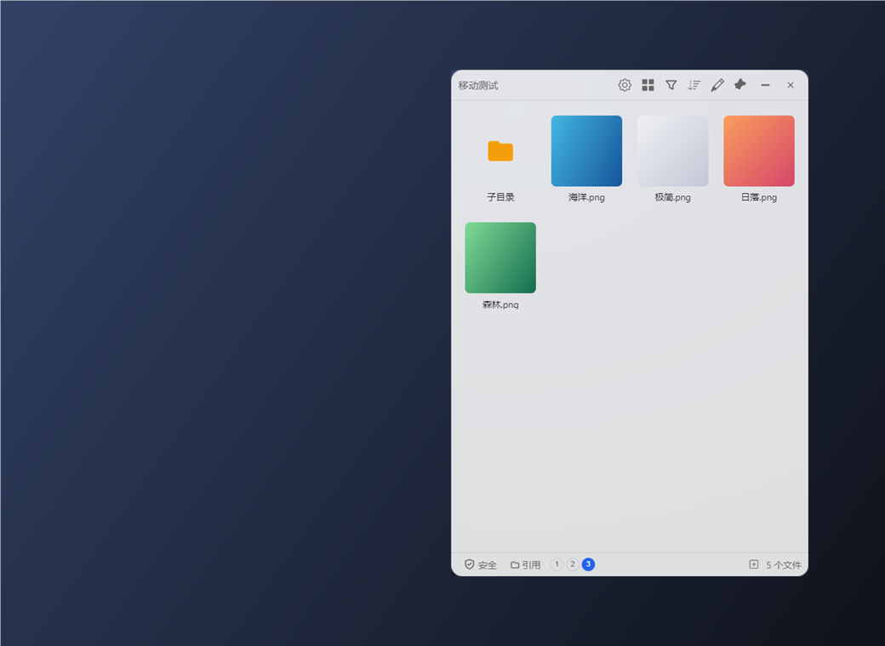
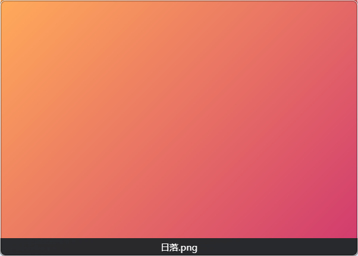
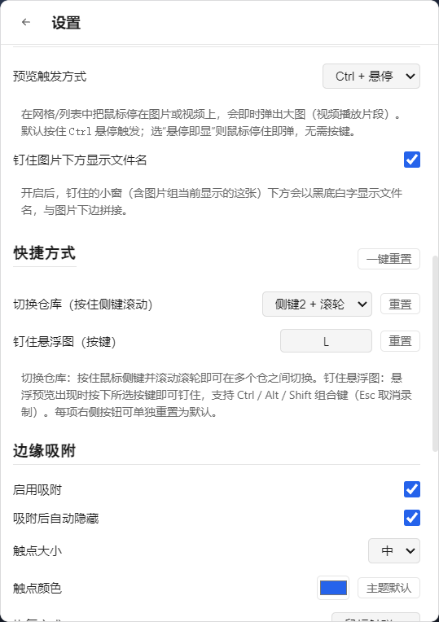

# FileDock · 文件仓

> 贴在屏幕边缘的透明收纳窗：文件、文本、图片，拖进来随手取用。
> 不用时缩成一根细线，鼠标一碰就滑回来。

Windows 10 / 11 (x64) · Electron · 无边框透明置顶 · 四向边缘吸附 · 纯本地运行

---

## 界面



<p align="center"><sub>网格视图：图片/视频直接出缩略图，主题没设计的格式用系统关联图标</sub></p>

<table>
<tr>
<td width="50%"><br><sub>按 L 钉住预览，下方显示文件名</sub></td>
<td width="50%"><br><sub>快捷方式设置区，可改组合键并一键重置</sub></td>
</tr>
</table>

---

## 目录

- [界面](#界面)
- [它解决什么问题](#它解决什么问题)
- [功能一览](#功能一览)
- [功能详解](#功能详解)
  - [1. 悬浮窗与边缘吸附（触点）](#1-悬浮窗与边缘吸附触点)
  - [2. 三种文件仓](#2-三种文件仓)
  - [3. 剪贴板仓](#3-剪贴板仓)
  - [4. 文件管理](#4-文件管理)
  - [5. 拖拽系统](#5-拖拽系统)
  - [6. 主题与个性化](#6-主题与个性化)
  - [7. 数据、隐私与便携](#7-数据隐私与便携)
- [和同类工具的差异](#和同类工具的差异)
- [操作速查](#操作速查)
- [快速开始](#快速开始)
- [从源码构建](#从源码构建)
- [已知限制](#已知限制)
- [路线图](#路线图)
- [License](#license)

---

## 它解决什么问题

用电脑的时候，总有些东西是"待会儿要用"的，但它们没地方待。

截图、刚下载的文件、临时要用的素材，懒得归类就丢桌面，桌面很快就满了。要把一个文件从资源管理器搬到聊天框或上传框，得先把两个窗口摆好、对齐，再拖过去。

剪贴板也是。复制一个东西，上一个就没了。想找回五分钟前复制的那段话，只能回去重新复制一遍。

FileDock 就是为这两件事做的：一个常驻屏幕边缘的小窗，把文件拖进去先放着，复制过的文本和图片自动留一份，要用的时候拖出来，或者点一下复制回去。窗口拖到屏幕边缘会自动缩成一根细线，不占地方，鼠标碰一下又滑出来。

## 功能一览

| 分类 | 功能 |
| --- | --- |
| **窗口** | 无边框透明窗、置顶（强层级，压得住全屏视频）、不占任务栏、托盘图标、关闭到托盘 |
| **吸附** | 四向边缘吸附（上/下/左/右）、自动折叠为触点、悬停或点击唤出、滑入动画、固定后暂停自动隐藏 |
| **三种仓** | 临时仓（只存引用，拖出即消失）、引用仓（绑定真实文件夹）、剪贴板仓（文本/图片/混排） |
| **剪贴板仓** | 后台自动全收、多格式快照、相邻去重、收藏、点按回写、拖出、多图/图文混排、暂停采集 |
| **文件管理** | 双击进入文件夹、面包屑导航、重命名、新建文件夹/文本/Markdown、回收站删除、安全/修改模式 |
| **批量** | 编辑模式、空白处框选、全选/全不选、批量移除/删除 |
| **视图** | 列表 / 网格切换、图片视频缩略图（网格大格、列表小图）、未知格式用系统图标、Ctrl+悬停大图/视频片段预览、按名称/时间/大小排序、按类型或后缀名筛选 |
| **拖拽** | 多文件拖出、文本/图文拖影跟手、松手贴进光标下的窗口 |
| **个性化** | 4 套主题（默认/猫耳/冰棍/玻璃窗）× 日间夜间、自定义强调色、自定义图标、顶栏按钮排序 |

---

## 功能详解

### 1. 悬浮窗与边缘吸附（触点）

窗口是**无边框、可透明**的，可以放在屏幕任何位置，并且使用 Electron 的 `screen-saver` 置顶层——**即使在全屏视频/游戏中也不会被盖住**。

把窗口拖到屏幕边缘（默认 20px 内）松手，它会：

1. 自动贴齐边缘；
2. 略等片刻后**折叠成一根细线（"触点"）**，尺寸可选小/中/大，颜色可自定义；
3. 鼠标**碰一下**（悬停模式）或**点一下**（点击模式）——自动从边缘外侧**滑入**，带淡入和缓动动画。

细节与开关：

- **触点跟随**：触点出现在窗口原位置偏中上/中左处，不会被甩到屏幕正中。
- **拖着文件靠近触点会自动展开**，可以直接把文件丢进去。
- **自动隐藏延迟**可调（0–3000ms 滑块，双击滑块数值可直接输入）。
- **吸附后不会立刻收起**：只要鼠标还在仓内就保持展开，移开鼠标后才按上面的延迟缩成触点。
- **图钉按钮（固定）**：固定后完全暂停自动吸附与隐藏，窗口就当普通浮窗用；取消固定时如果还在边缘，会重新走一遍吸附流程。
- **最小化按钮**：不在吸附边缘时收进托盘；已在边缘时直接折叠为触点（固定状态会先自动解除）。
- **触点永远置顶**：就算你关掉了主窗口置顶，触点仍然保持最高层级——它是"dock 在这儿"的唯一线索，被盖住用户就找不到了。

### 2. 三种文件仓

一个窗口里可以建任意多个"仓"，底部状态栏用序号圆点切换，也可以按 <kbd>←</kbd> / <kbd>→</kbd> 键翻。**每个仓独立记住自己的窗口位置、大小和视图模式（列表/网格）。**

| 仓类型 | 内容来源 | 拖出 / 删除的影响 |
| --- | --- | --- |
| **临时仓**（temporary） | 你拖进去的文件，只存**引用** | 默认拖出后引用从仓里消失，**真实文件不受影响**（可在设置里改成拖出后保留） |
| **引用仓**（reference） | 绑定一个**真实文件夹**，仓内是该文件夹的实时视图 | **安全模式**下操作不落地；**修改模式**下拖入/拖出/删除会真实改动文件夹 |
| **剪贴板仓**（clipboard） | 后台自动采集的剪贴板历史 | 见下一节 |

文件仓可以在 **托盘菜单 → 新建文件仓 / 文件仓管理**，或点状态栏左下角的 `+` 进入管理面板。新建引用仓时可以直接**把文件夹拖到面板上**来填路径；路径留空会自动建一个空文件夹。

### 3. 剪贴板仓

这是 FileDock 最有意思的部分：在同一个 dock 里叠加一层"**内容暂存层**"，把复制过的东西也收进来。

**自动全收。** 后台持续监听剪贴板，你复制什么它就存什么，不用手动点。

**多格式快照。** 一次复制 = 一条记录，**同一来源的多种格式存在一起**（不再把一段带图文字拆成几条）：

| 类型 | 含义 |
| --- | --- |
| 文本 | 纯文字 |
| 富文本 | 保留加粗、排版等结构 |
| 图片 | 复制的是图片本身 |
| 多图 | 一次复制了多个图片文件 |
| 图片+文字 | 混排——比如从 QQ 复制一条带表情/配图的消息 |

**图文混排也能还原。** 从 QQ 这类程序复制带表情或配图的消息时，FileDock 会按**原文的图文顺序**完整保留，拖出时尽量还原原来的排版。

**去重。** 连续复制同一个东西不会重复入仓。注意只对**相邻**记录去重：隔了几条之后再次复制同样的内容，仍会作为新记录出现。

**怎么用：**

| 操作 | 效果 |
| --- | --- |
| **单击卡片** | 展开全文 / 大图（同一时间只展开一张） |
| **悬停卡片** | 右侧滑出三个按钮：复制回写 / 收藏 / 删除 |
| **复制回写** | 把 `文本 + 富文本 + 图片` 按多格式一次性写回剪贴板，然后到目标窗口 <kbd>Ctrl</kbd>+<kbd>V</kbd>——这是最通用的用法 |
| **按住卡片拖出** | 图片/多图 → 以**文件**形式拖出（能拖进聊天框、上传框），落盘名为 `Clip_年月日-时分秒.png` 唯一命名，连续拖进同一文件夹不会互相覆盖；文本/富文本/图文 → 出现一个**跟随光标的拖影小标签**，松手时自动**贴进光标所在的那个窗口** |
| **<kbd>Ctrl</kbd> + 点击** | 多选，配合垃圾桶按钮批量删除 |
| **右键卡片** | 复制 / 收藏 / 删除 / 清空全部 |
| **底部垃圾桶按钮** | 三态智能按钮：有选中 → 删选中；有展开的卡片 → 删这张；都没有 → 清空全部 |
| **<kbd>Ctrl</kbd>+<kbd>V</kbd>** | 在剪贴板仓里手动把"当前剪贴板"立刻收一份进来 |
| **全部 / 收藏** 分段 | "收藏"只看你手动标星或置顶过的条目 |
| **暂停按钮** | 一键停止自动采集（输密码、处理隐私内容时用） |

**列表顺序是稳定的。** 复制回写和拖出都**不会**把条目挪到顶部，所以可以按顺序一条条往下粘，列表不会在光标底下跳动；只有新复制的内容才会出现在最上面。

**隐私与自我写入抑制：**

- 采集、暂停、清空三个开关随手可用，**数据全部存在本地**，不联网、不上传。
- **自我写入抑制**：FileDock 自己写剪贴板（复制回写、拖出贴入）后，那一次变化不会被重新采集成新记录——不然拖一次就多一条垃圾。
- 纯短文本（默认 < 5 字符、无图无富文本）默认不入仓，避免验证码、单个字母塞满列表。
- 条数上限默认 200 条，超出时从最旧的**未收藏**条目开始淘汰（收藏/置顶的记录不会被自动清掉），同时清理对应的数据文件。超长文本与富文本会落成独立文件，历史索引始终轻量。
- **新内容增量插入**：后台采到新内容时直接插到列表顶部，已选中的卡片、展开的卡片和滚动位置都不会被打断；正在看列表中部时视野保持不动。

### 4. 文件管理

把窗口当一个小型文件管理器用：

- **双击文件夹进入**，顶部出现**面包屑**，点任意层级快速跳回，左侧 `←` 返回上一级。
- **空白处右键**：新建文件夹 / 新建文本文件 / 新建 Markdown 文档 / 刷新当前内容 / 在资源管理器中打开。新建时重名会自动加 `(1)`、`(2)`。
- **文件右键**：打开 / 在文件夹中显示 / 重命名 / 从列表移除 / 从磁盘删除（删除走**系统回收站**，可撤销）。重命名会拦掉 `\ / : * ? " < > |` 等非法字符。
- **两种操作模式**（状态栏左下角切换）：
  - **安全模式**（默认）：引用仓与文件夹浏览中的操作**不影响真实文件**——拖进去只是临时显示，拖出来文件不会少，右键菜单里的"从磁盘删除"会被隐藏。
  - **修改模式**：拖入/拖出/删除**真实改动文件夹内容**，删除仍走回收站。首次切换会弹警告。
- **编辑模式**（顶部铅笔按钮）：**按住空白处拖动即可框选**多个文件（带起拖阈值，随手单击空白不会误触框选）；底部弹出操作条：全选 / 全不选 / 移除 / 从磁盘删除 / 完成。**双击空白处**可快速退出。顶部有**搜索框**：按文件名实时过滤、与筛选规则叠加生效，右侧按钮一键切换「仅当前目录 / 含所有子目录」递归搜索；切换目录会清空搜索。
- **视图与筛选**：列表 / 网格一键切换；排序支持顺序/逆序 × 名称/时间/大小；筛选面板可按**类型**（图片、视频、文档、压缩包、快捷方式 `.lnk`/`.url` …）或按**后缀名**勾选，多选生效，面板顶部有**全选/全不选**切换条。
- **网格缩略图**：网格视图中图片、视频直接显示缩略图（视频带播放角标），列表视图用小尺寸缩略图；主题没有设计图标的格式显示 **Windows 关联应用的图标**（如 `.psd` 显示 Photoshop、`.lnk` 显示目标程序）。缩略图只对滚入可视区的文件按需生成，不拖慢大文件夹。GIF 在网格/列表显示静态首帧，悬停预览播放完整动画。
- **Ctrl + 悬停预览**：把鼠标停在图片或视频上**即时**弹出置顶预览窗（无防抖、无过渡动画，为大量看图/调图场景优化）——图片按原始比例显示大图，视频自动循环播放片段；预览窗自动避开屏幕边缘绝不超出屏幕，移开鼠标即关闭。尺寸策略：**原始尺寸优先**，超过上限（约半屏）等比缩小，过小（<160px）轻微放大到下限；钉住后尺寸与悬浮时完全一致。触发方式可在设置里改为**悬停即显**（默认按住 <kbd>Ctrl</kbd>）。
- **按 <kbd>L</kbd> 钉住预览**：预览弹出的状态下按 <kbd>L</kbd>，它就升级为一个独立小窗——可以拖着到处走、拉边等比缩放；鼠标靠近右上角会出现 × 关闭（<kbd>Esc</kbd> 也可以）。钉住后不受悬停/失焦影响，适合一边对照大图一边干活。
- **图片组**：编辑模式里多选若干张图片，Ctrl 悬停其中任意一张按 <kbd>L</kbd>，它们会钉成**一个**窗口——鼠标靠近左右边缘浮现 ‹ › 箭头（<kbd>←</kbd>/<kbd>→</kbd> 也行），在组内逐张翻看，窗口自动贴合每张图的尺寸。适合一批实验图对照着看。
- **钉住图下方显示文件名**：设置里可开启，黑底白字与图片下边拼接；可选常显或靠近底边才出现。

### 5. 拖拽系统

拖出分两条路，按内容类型自动选择：

- **文件 / 图片**：直接把文件拖到目标程序，微信、QQ、浏览器上传框、资源管理器都能接收。拖动跟手的图案是**文件本身的缩略图 + 下方文件名**（多选显示 ×N），不再是一个色块。**拖出又放回原处等于取消**，不会把文件改名成 "xxx (1)"。
- **文本 / 富文本 / 图文**：按下并移动后，会出现一个**跟随光标的深色小标签**显示内容摘要；松开时内容自动**落进光标所在的那个窗口**。这样即使目标程序不接受文本拖放（很多聊天框、网页输入框都是），也能贴进去。

### 6. 主题与个性化

- **4 套主题**：默认（清爽）、猫耳（粉色，窗口外会长出两只猫耳）、冰棍（青色，底部有融化波浪和木棍）、玻璃窗（磨砂玻璃质感，带折射光斑与顶部霜面）。
- **日间 / 夜间**两套配色，一键切换。
- **强调色**：任意取色会覆盖所有主题的主题色；点"主题默认"即可还原。
- **应用图标**：内置文件夹 / 字母 / 仓库三款图标，也可上传 PNG / JPG / SVG 自定义，实时应用到托盘与任务栏。
- **顶栏按钮排序**：**长按并拖动**顶栏按钮即可调整顺序，顺序会被记住。

### 7. 数据、隐私与便携

- **纯本地**。所有数据存在本机，没有任何网络请求、账号或遥测。
- **数据跟文件夹走**：绿色版把配置放在 **exe 同级的 `config/` 文件夹**，放 U 盘里换台电脑，配置和剪贴板历史一起带着走。
- 配置和剪贴板历史都存放在 `config/` 下（其中 `config/clipvault/` 是剪贴板历史本体）。
- **单实例**：重复启动会唤醒已有窗口，不会开出第二个 dock。

---

## 和同类工具的差异

| 能力 | 剪贴板管理器（Ditto / Win+V） | 传统文件收纳/Dock 工具 | **FileDock** |
| --- | :---: | :---: | :---: |
| 收纳文件 | ✗ | ✓ | ✓ |
| 收纳文本 / 图片 / 富文本 | ✓ | ✗ | ✓ |
| 常驻边缘、一碰就出 | ✗ | 部分支持 | ✓ |
| 拖出到其它程序 | 仅纯文本 | 仅文件 | 文件 + 文本 + 图文混排 |

核心差异是**同一个 dock 里，文件、文本、图片统一收纳、统一拖出**，不用在两个工具之间倒手。

---

## 操作速查

| 我想…… | 怎么做 |
| --- | --- |
| 存一个文件 | 把文件拖进窗口 |
| 打开文件 / 进入文件夹 | 单击文件 / 双击文件夹 |
| 把文件拿到别处 | 从窗口里把文件拖到目标程序 |
| 让窗口靠边藏着 | 把窗口拖到屏幕边缘，它会缩成一根细线 |
| 把窗口叫出来 | 鼠标碰一下（或点一下）那根细线 |
| 让窗口别乱跑 | 点图钉按钮固定 |
| 换个文件仓 | 按 <kbd>←</kbd> / <kbd>→</kbd>，或点底部序号圆点 |
| 批量选文件 | 进编辑模式，按住空白处拖动框选 |
| 放大看一张图 / 播放视频片段 | 鼠标悬停在图片或视频上（默认需按住 <kbd>Ctrl</kbd>，可在设置改为悬停即显） |
| 让预览变成可拖动的小窗 | 预览弹出时按 <kbd>L</kbd>；靠近右上角点 ×（或 <kbd>Esc</kbd>）关闭 |
| 把多张图钉成一组翻看 | 编辑模式多选图片 → Ctrl 悬停其中一张按 <kbd>L</kbd> → 靠近左右边缘出现箭头 |
| 找到刚才复制的东西 | 切到剪贴板仓，单击卡片看全文 |
| 把复制过的内容再贴一次 | 剪贴板仓里点卡片的"复制"，然后到目标窗口 <kbd>Ctrl</kbd>+<kbd>V</kbd> |
| 把一段文字/图文拖进聊天框 | 按住剪贴板卡片拖到目标窗口松手 |
| 临时停止记录剪贴板 | 剪贴板仓的暂停按钮 |
| 调整按钮顺序 | 长按顶栏按钮拖动 |
| 换个文件仓（鼠标） | 按住鼠标侧键 2 滚动滚轮 |
| 把文件移到另一个文件夹 | 修改模式下，把文件直接拖到目标文件夹上松手 |
| 复制一个文件的路径 | 右键文件 → 复制路径 |
| 改快捷键 | 设置 → 快捷方式（每项可单独重置，标题右侧一键重置） |

---

## 快速开始

### 方式一：下载绿色版（推荐）

到 [Releases](https://github.com/AutoOperator/FileDock/releases) 下载 `FileDock-Green-*.zip`，解压到任意位置（比如 `D:\FileDock`），双击其中的 `FileDock.exe` 即用，**无需安装**。

- 配置和数据都在解压目录的 `config/` 文件夹里（其中 `config/clipvault/` 是剪贴板历史本体），整个文件夹拷走即完成迁移。

### 系统要求

- **Windows 10 / 11，x64**
- 无需安装 Node.js 或任何运行时（绿色版已内置 Electron）

> 目前仅支持 Windows 10 / 11。

## 从源码构建

### 前置

| 依赖 | 版本 | 用途 |
| --- | --- | --- |
| Node.js | 18+ | 运行与打包 |
| Python | 3.x | `node-gyp` 编译原生模块 |
| MSVC (VS 2022 Build Tools) + Windows SDK | — | 编译 `native-drag` C++ 模块 |

### 开发运行

```bash
git clone https://github.com/AutoOperator/FileDock.git
cd FileDock
npm install

# 构建原生拖拽模块（需 MSVC）
cd native-drag && npm install && npm run build && cd ..

npm start          # 启动
npm run dev        # 启动并打开 DevTools
```

> `native-drag` 是可选的：**编译失败或缺失时应用仍能正常运行**，只是文本拖出会降级。

### 打包

```bash
npm run build        # 绿色文件夹版 → dist/文件仓/
npm run build:dir    # 仅目录版（中间产物，一般不用）→ dist/win-unpacked/
```

绿色版目录结构（推荐分发给用户，根目录一眼可见）：

```
dist/文件仓/
├─ FileDock.exe     双击运行（40KB 启动器，源码 tools/launcher/launch.c）
├─ 使用说明.txt
├─ app/             运行核心（Electron 运行时 + 应用本体，无需关心）
└─ config/          配置与数据（跟文件夹走）
```

`build/build-portable.sh` 是一份在 Linux 下用 wine 交叉构建 Windows 便携版的脚本，供 CI/沙箱环境使用。

### 诊断日志

渲染层错误、崩溃和拖拽会话异常会写到 `%TEMP%\filedock.log`，排查问题时先看这里。

---

## 已知限制

- **仅支持 Windows 10 / 11（x64）**。
- **富文本还原度受目标程序影响**：粘贴到 Word / 网页 / QQ 的效果各有差异，取决于对方是否支持富文本。
- **相邻去重**意味着隔了几条后再次复制相同内容会重复出现。
- **剪贴板历史未加密**，以明文存在本地；介意的话请用暂停开关或定期清空。
- **视频缩略图与片段预览依赖 Chromium 解码能力**：MP4/WebM/M4V 等常见格式可直接出图和播放；AVI/MKV/WMV 等不支持的格式会退回显示关联应用图标。
- **TIFF/HEIC 等特殊图片格式**无法生成缩略图与大图预览，同样退回系统图标。

## 路线图

- [ ] 剪贴板历史可选加密存储
- [ ] 按来源应用过滤/忽略规则
- [ ] 文本 / 图文拖出在更多目标程序上的兼容性打磨
- [ ] 剪贴板内容一键落盘进文件仓（内容层 ↔ 文件层打通）
- [ ] 更多主题与自定义外观

## License

[MIT](LICENSE)

本工具完全免费，没有付费版，也没有任何增值收费项。如果你看到有人在售卖它，那不是作者。

---

<sub>如果这个工具对你有用，欢迎点个 Star ⭐ 或到 [Issues](https://github.com/AutoOperator/FileDock/issues) 提反馈。</sub>
